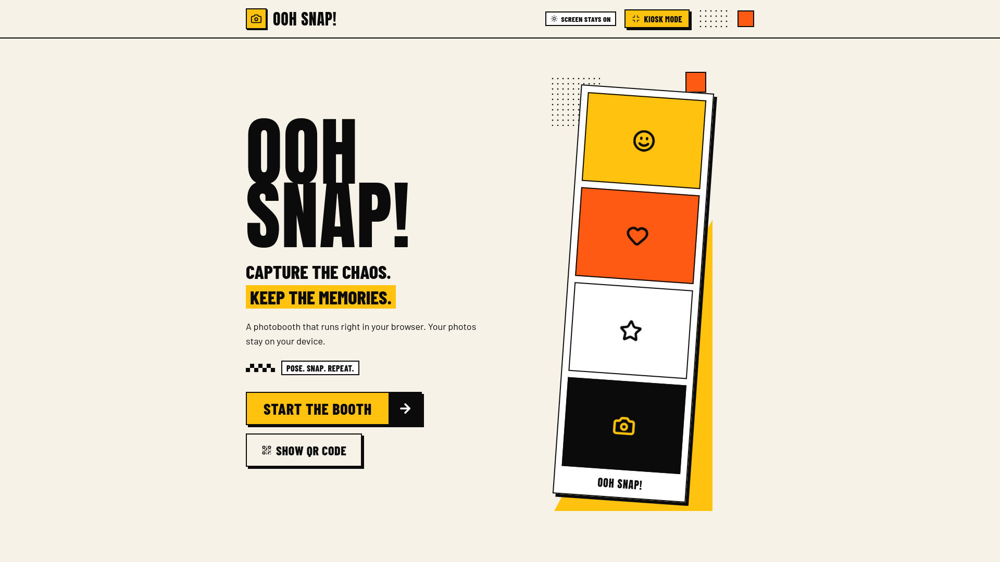
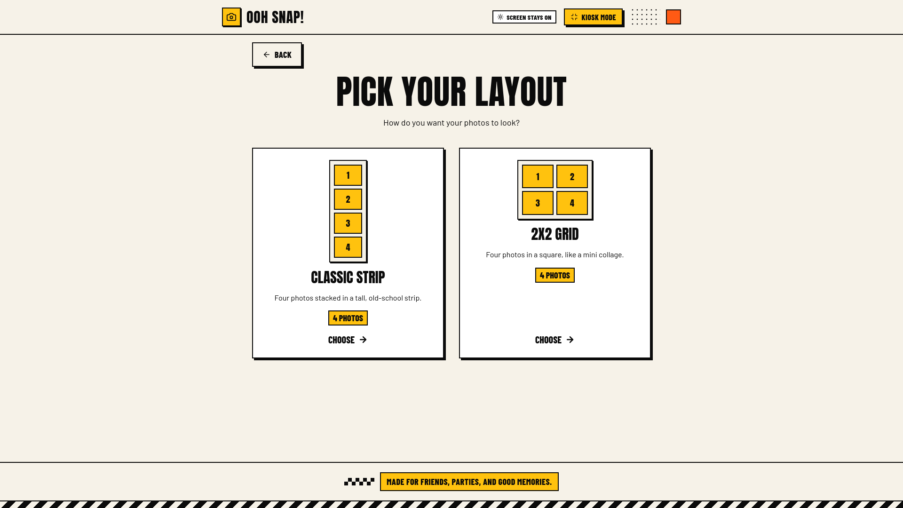
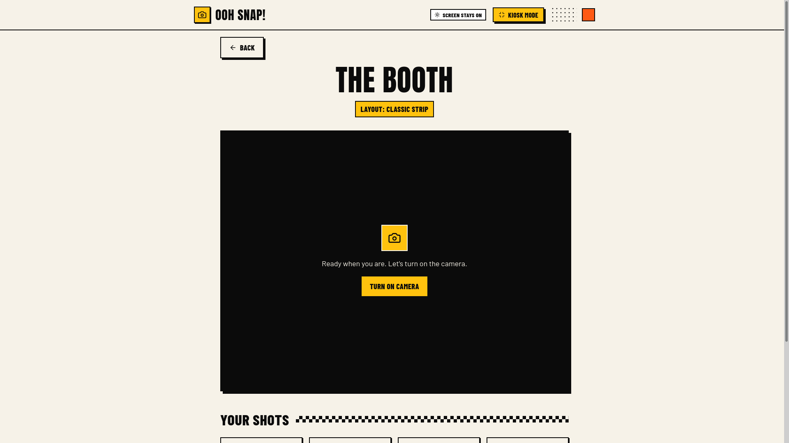
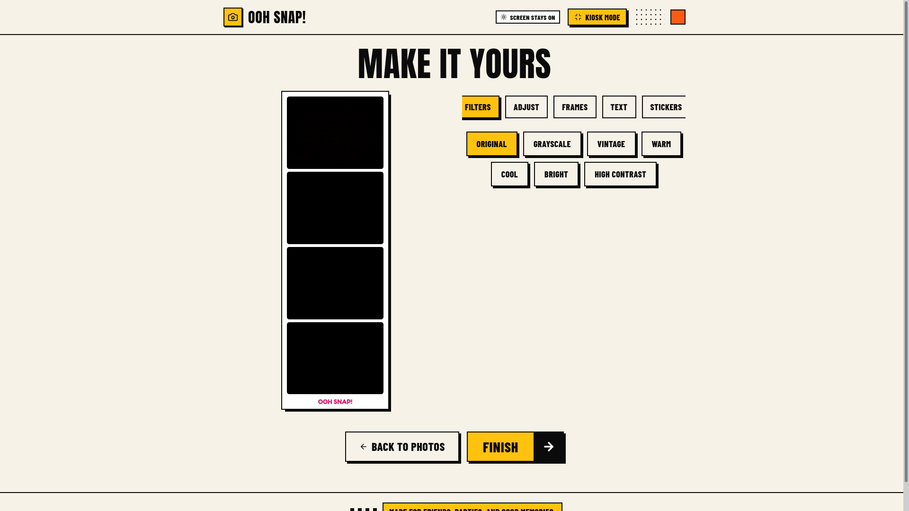
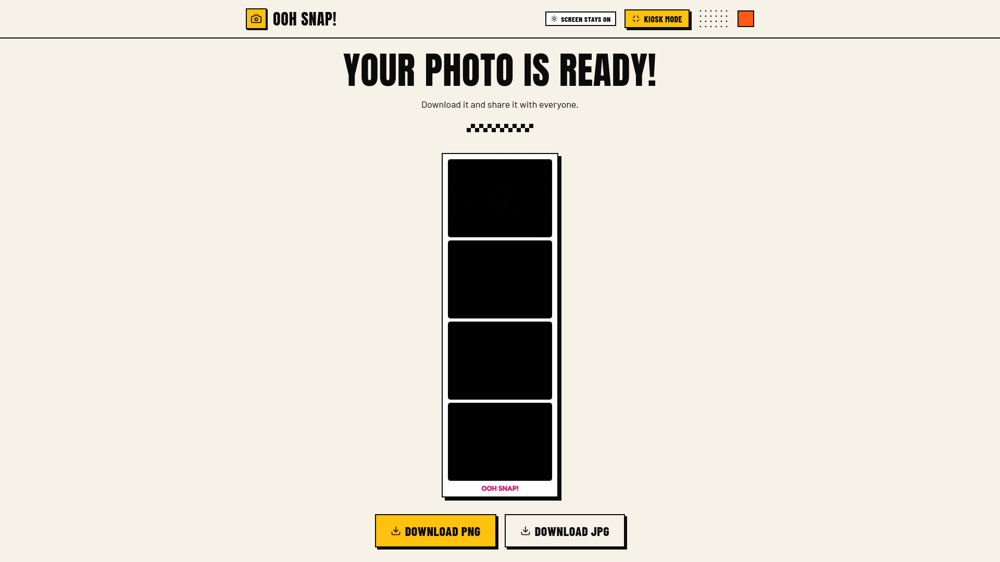
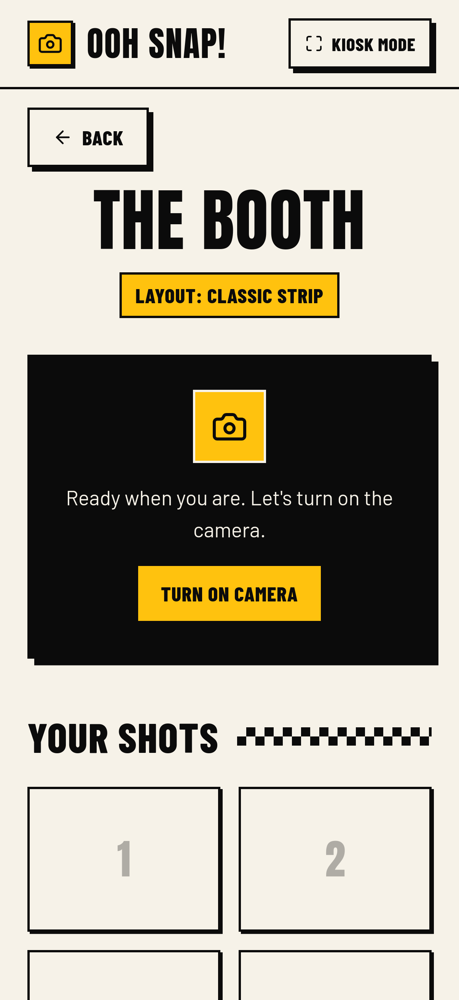

# Ooh Snap!

> Capture the chaos. Keep the memories.

A photobooth that runs entirely in your browser. Pose with your friends, take a strip of photos with a countdown, decorate it with filters, frames, stickers and text, then download it or share it. There is no sign-up and no server, and your photos never leave your device.

**[Try it live](https://ooh-snap.vercel.app)**



| Pick a layout | Strike a pose |
| --- | --- |
|  |  |

| Make it yours | Keep it |
| --- | --- |
|  |  |



## Features

**Taking photos**

- Live camera preview, with a front and back camera switch on devices that have more than one
- A 3, 5 or 10 second countdown, remembered between visits
- A capture flash and a synthesized shutter sound (can be turned off)
- Two layouts: Classic Strip and 2x2 Grid
- Retake any single photo without losing the others

**Making it yours**

- 7 filters: Original, Grayscale, Vintage, Warm, Cool, Bright and High Contrast
- Brightness, contrast and saturation sliders
- 3 frames: Minimal, Noir and Party
- A text caption with 4 fonts, 5 colours, a size and a tilt
- 10 custom PNG stickers that can be dragged, resized and removed

**Keeping it**

- Download as PNG or JPG
- Share through the phone's own share menu (Web Share API)
- A QR code that opens the booth on another phone

**Running it at a party**

- Kiosk mode: fullscreen, and the screen is kept awake
- After 90 seconds without a touch, a "Still there?" warning appears. If nobody answers, the booth clears the last guest's photos and returns to the start screen

**For everyone**

- Responsive and touch friendly, with larger tap targets on touch screens
- Keyboard accessible, with visible focus and screen reader labels
- Respects the "reduce motion" setting

## Privacy by design

The app has no backend, database or user accounts. The camera stream is never uploaded. Photos exist only in the browser's memory while you use the booth, and they are released when you start over. Only two small preferences (countdown length and shutter sound) are saved in `localStorage`.

## Tech stack

| Area | Choice | Why |
| --- | --- | --- |
| UI | React and TypeScript | Components and hooks keep the booth's states manageable, and typed props and state catch mistakes at build time |
| Build tool | Vite | A fast dev server and a plain static build that Vercel can host for free |
| Styling | Tailwind CSS v4 | Colours, fonts and the hard shadows live in one `@theme` block, so the whole design can change in one place |
| Routing | React Router | A multi-page flow without full reloads |
| Animation | Framer Motion | Page transitions and the countdown, with reduced-motion support |
| Icons | Lucide React | Small, consistent SVG icons |
| QR codes | qrcode.react | Renders a QR code as crisp SVG |
| Browser APIs | MediaDevices, Canvas 2D, Web Share, Fullscreen, Screen Wake Lock, Web Audio, localStorage | Everything a photobooth needs, with no backend |
| Hosting | Vercel (Hobby plan) and GitHub | Every push to `main` deploys automatically |

## How it works

```text
Home -> Choose layout -> Booth -> Review -> Editor -> Final
         (session)       camera    raw      edits    download,
                         + capture photos            share
```

A **session** (layout, photos, filter, frame, caption, stickers) lives in a React context above the router, so it survives moving between pages. Starting a new shoot clears it.

### Technical highlights

- **Camera lifecycle.** A `useCamera` hook wraps `getUserMedia`. It stops every track when the page closes, ignores a stream that arrives after the visitor has left (a request counter acts as a ticket), and turns browser error names such as `NotAllowedError` and `NotReadableError` into friendly messages.
- **One set of measurements, two renderers.** The on-screen sheet (CSS) and the downloaded image (Canvas) are both built from the numbers in `sheetMetrics.ts`, so what you see is what you download.
- **Positions as fractions.** Stickers and the caption store their position and size as fractions of the sheet. They land in the same place on any screen size and in the full-resolution export.
- **One filter string.** The same CSS `filter` value drives the `` preview and `context.filter` on the canvas.
- **Simple state.** `useState`, `useRef` and two small React contexts (session and toasts). No state library was needed.
- **Large images.** Photos are JPEG blobs referenced by object URLs, not base64 strings in state, and each URL is revoked when its photo is replaced or cleared. The heavy canvas work happens once, on the final page.
- **Drag with Pointer Events.** One implementation covers mouse, touch and pen, with arrow-key movement for keyboard users.
- **Kiosk mode.** The Fullscreen API, a Screen Wake Lock that is re-acquired when the tab becomes visible again, and an idle timer built from timestamps instead of a restarting timeout.
- **Accessibility.** Native `<dialog>` elements, a keyboard-operable tab widget, focus moved to the new page on navigation, live regions for status messages, and decorative graphics hidden from screen readers.

## Project structure

```text
src/
  assets/stickers/   PNG stickers. Add a file here and it appears in the editor
  components/        camera, editor, home, layout, share and ui pieces
  context/           session and toast state
  data/              layouts, filters, frames, stickers, settings
  hooks/             camera, countdown, fullscreen, wake lock, idle timeout...
  pages/             Home, Templates, Booth, Review, Editor, Final, NotFound
  types/             shared TypeScript types
  utils/             canvas composition, export, sharing, sheet measurements
public/              favicon and robots.txt
vercel.json          routes every address to the app, so direct links work
```

## Getting started

You need Node.js 20.19+ or 22.12+.

```bash
git clone https://github.com/rellmon/Ooh-Snap-.git
cd Ooh-Snap-
npm install
npm run dev
```

Then open the address Vite prints, usually `http://localhost:5173`.

| Command | What it does |
| --- | --- |
| `npm run dev` | Starts the development server |
| `npm run build` | Type-checks and builds the production site into `dist/` |
| `npm run preview` | Serves the production build locally |
| `npm run lint` | Runs ESLint |

Browsers only allow the camera on `https` pages and on `localhost`. To try the app on a phone, use the deployed site or a preview deployment.

## Deployment

The site is deployed on Vercel's free Hobby plan. Vercel builds from the `main` branch on every push. `vercel.json` rewrites unknown addresses to `index.html`, because React Router handles the pages in the browser. Without that rule, opening or refreshing a link such as `/editor` would give a 404.

## Browser support and testing

- Developed and tested on [ Zen Browser, Chrome, Vivaldi, Brave and Arc Search on a Samsung Android phone ].
- **Not yet tested on iOS and Safari.** Downloaded images rely on the canvas `filter` property, which Safari may not support.
- The Share button only appears where the browser can share files. Fullscreen and kiosk mode are not available on iPhones.
- Lighthouse on mobile at the time of writing: Performance 91, Accessibility 100, Best Practices 100, SEO 100.

## Known limitations and ideas

- Photos are not kept across a page reload. A warning appears before a reload or close. Saving a session in IndexedDB would remove that limit.
- A QR code that opens a specific photo needs hosted storage, a small serverless function and a change to the privacy promise, so it is deliberately not included.
- The caption is a single line of up to 20 characters.

## Credits

- Fonts from Google Fonts: Anton, Barlow, Barlow Condensed, Fredoka, Nunito, Pacifico and Bangers (SIL Open Font License)
- Icons by Lucide (ISC license)
- QR codes by qrcode.react (ISC license)
- Sticker artwork: [ Rohim from Flaticon ]
- Built by [ Rexzell Abad ] ([GitHub](https://github.com/rellmon))